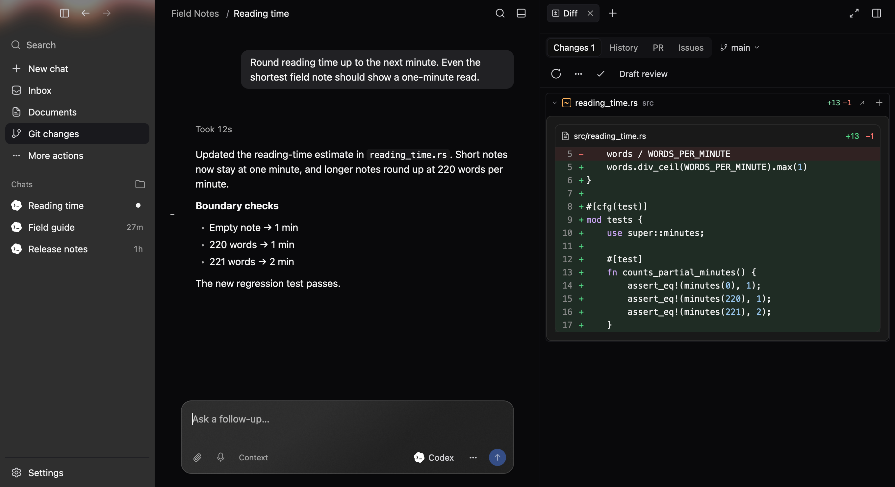

# Kwrok

Kwrok is a native Rust and GPUI desktop for coding with Kar. Click a filename in an agent’s reply to read the diff beside the conversation, then ask a follow-up in the same chat.

**[Download for Apple Silicon](https://github.com/kense-labs/kwork/releases/download/v0.23.0-native-preview.1/Kwrok-0.23.0-macOS-arm64.dmg)** · [Review a change](#review-a-change) · [Offline dictation](#offline-dictation) · [Build from source](#build-from-source) · [简体中文](README.zh.md)

<p align="center">
  <br>
  <sub>The Field Notes project with the diff for <code>src/reading_time.rs</code> open beside the conversation.</sub>
</p>

## Install

Open the DMG and drag **Kwrok** to **Applications**. This preview is for Apple Silicon Macs. The release page includes the SHA-256 checksum and signing details. [Release notes](https://github.com/kense-labs/kwork/releases/tag/v0.23.0-native-preview.1)

Choose a project folder. Kwrok includes a built-in default agent runtime out of the box; you can also connect external agents in **Settings → Agents & Accounts** and click **Set default** to use one for new chats.

## Review a change

1. **Ask for a small edit.** In a Git project, try “Add a short section to the README explaining how to run the tests.”
2. **Click the changed filename.** Expand the changed-files list in the reply and click `README.md`. The right panel shows the additions and deletions alongside the chat.
3. **Follow up.** Ask “Which of those tests can I run offline?” in the same composer. When you reopen Kwrok, you can continue the conversation with its original agent.

To have the agent review the change, choose **Git changes → Draft review**. Kwrok fills the composer with a review request for the current changes or latest commit. You can edit the request and send it when ready.

| In the workbench | What you can do |
| --- | --- |
| Chat commands | Type `/` to see actions available in this session. In Codex, `/goal` manages a persistent goal. `/plan` opens a read-only planning thread. Choose **Implement plan** to carry it out in the original chat. |
| Files and terminal | Browse the working directory, run a command in the integrated terminal, or open a document, spreadsheet, or slide deck in the embedded Office editors. |
| Remote | Share a Kar chat or create a desktop-assistance invitation. Desktop invitations open a separate client, such as UU Remote on macOS. |

## Offline dictation

Click the microphone in the composer, speak, and click again to stop. Kwrok places the transcript in the draft so you can edit it before sending. The DMG includes the Rust CPU recognizer and multilingual Whisper Base model. Local dictation and automatic language detection work offline, including for English and Mandarin.

## Build from source

Install stable Rust and the platform build tools. On macOS, install Xcode and its command-line tools. Run the following command from the repository root. Cargo fetches the pinned Kar revision on the first build.

```sh
cargo run --locked -p kar_desktop -- --workspace /path/to/project
```

For offline dictation from a source checkout, run `cargo install --locked --path crates/kwrok_dictation`, then download and select **Whisper Base** in the voice settings.

**Run the tests**

```sh
cargo test --locked -p kwrok_dictation
cargo test --locked -p kar_desktop
```

**Build the macOS app**

```sh
cargo build --locked -p kar_desktop
./scripts/macos-kwrok-app.sh target/debug/kar-desktop target
open target/Kwrok.app
```

[Desktop source](crates/kar_desktop) · [Dictation source](crates/kwrok_dictation) · [Kar runtime](https://github.com/kense-labs/Kar) · [Kantor Office](KANTOR.md)

## Licenses

Kense’s original code in Kwrok and Kar is available under MIT. The desktop app incorporates Kantor Office and is distributed as a whole under AGPL-3.0-or-later. Third-party components retain their own licenses. [Kwrok MIT license](LICENSE-MIT) · [Kar license](https://github.com/kense-labs/Kar/blob/main/LICENSE) · [Desktop license](LICENSE) · [Third-party notices](NOTICE)
