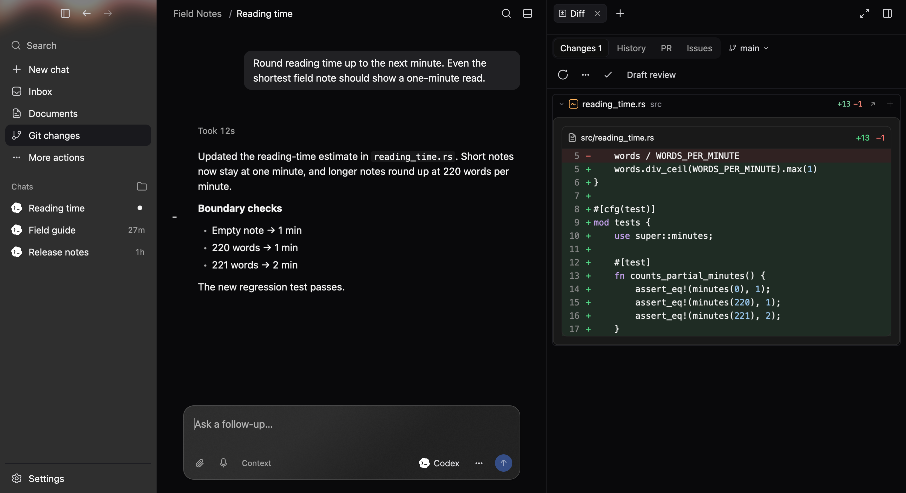

# Kwrok

Kwrok 是用 Rust 和 GPUI 构建的 Kar 原生桌面工作台。在智能体的回复里点击文件名，就能在对话旁查看改了哪些行，接着在原对话里追问。

**[下载 Apple Silicon 版](https://github.com/kense-labs/kwork/releases/download/v0.23.0-native-preview.1/Kwrok-0.23.0-macOS-arm64.dmg)** · [审查一次改动](#审查一次改动) · [离线听写](#离线听写) · [从源码构建](#从源码构建) · [English](README.md)

<p align="center">
  <br>
  <sub>Field Notes 项目的对话旁展开了 <code>src/reading_time.rs</code> 的逐行差异。</sub>
</p>

## 安装

打开 DMG，将 **Kwrok** 拖入「应用程序」。本次预览版适用于搭载 Apple Silicon 的 Mac。发布页提供 SHA-256 校验值和签名说明。[查看发行说明](https://github.com/kense-labs/kwork/releases/tag/v0.23.0-native-preview.1)

选择一个项目文件夹。新对话默认使用 Aster。要使用 Aster，请在「设置 → 智能体与账号」中安装 Aster ACP，然后在 Aster 中配置模型服务。也可以选择已安装的其他智能体。

## 审查一次改动

1. **请智能体做个小修改。** 在一个 Git 项目里试试：“在 README 里加一段说明，告诉我怎么运行测试。”
2. **点开改过的文件。** 展开回复里的文件变更列表，点击 `README.md`。右侧会显示新增和删除的行，对话仍在旁边。
3. **接着问。** 在原输入框里问：“这里面哪些测试可以离线运行？” 重新打开 Kwrok 后，还可以在这段对话里和原来的智能体继续讨论。

需要智能体再审查一遍时，选择「Git 变更 → 起草审查请求」。Kwrok 会根据当前变更或最近一次提交把审查请求填入输入框，编辑后即可发送。

| 工作台入口 | 用法 |
| --- | --- |
| 对话指令 | 输入 `/` 查看当前会话可用的操作。Codex 的 `/goal` 可管理持续目标，`/plan` 会开启只读规划对话。确认后点击「实施计划」，回到原对话执行。 |
| 文件与终端 | 浏览项目文件，在集成终端运行命令，或用内置 Office 编辑器打开文档、表格和演示文稿。 |
| 远程 | 分享 Kar 对话，或创建远程桌面协助邀请。桌面邀请会交给独立客户端打开，例如 macOS 上的 UU 远程。 |

## 离线听写

点击输入框的麦克风开始录音，再点一次结束。识别出的文字会进入草稿，可以修改后发送。DMG 内含 Rust CPU 识别引擎和多语言 Whisper Base 模型，中英文听写和自动辨别语言都可以离线使用。

## 从源码构建

安装稳定版 Rust 和对应平台的构建工具。macOS 需要 Xcode 及其命令行工具。在仓库根目录运行下面的命令。首次构建时，Cargo 会下载项目锁定的 Kar 版本。

```sh
cargo run --locked -p kar_desktop -- --workspace /path/to/project
```

从源码启动时，运行 `cargo install --locked --path crates/kwrok_dictation` 安装听写程序，再到语音设置中下载并选择 **Whisper Base**，即可离线听写。

**运行测试**

```sh
cargo test --locked -p kwrok_dictation
cargo test --locked -p kar_desktop
```

**构建 macOS 应用**

```sh
cargo build --locked -p kar_desktop
./scripts/macos-kwrok-app.sh target/debug/kar-desktop target
open target/Kwrok.app
```

[桌面端源码](crates/kar_desktop) · [听写引擎源码](crates/kwrok_dictation) · [Kar 运行时](https://github.com/kense-labs/Kar) · [Kantor Office](KANTOR.md)

## 开源许可

Kense 原创的 Kwrok 和 Kar 代码采用 MIT 许可。桌面应用集成了 Kantor Office，组合后的应用整体按 AGPL-3.0-or-later 分发。第三方组件保留各自的许可证。[Kwrok MIT 许可证](LICENSE-MIT) · [Kar 许可证](https://github.com/kense-labs/Kar/blob/main/LICENSE) · [桌面应用许可证](LICENSE) · [第三方声明](NOTICE)
